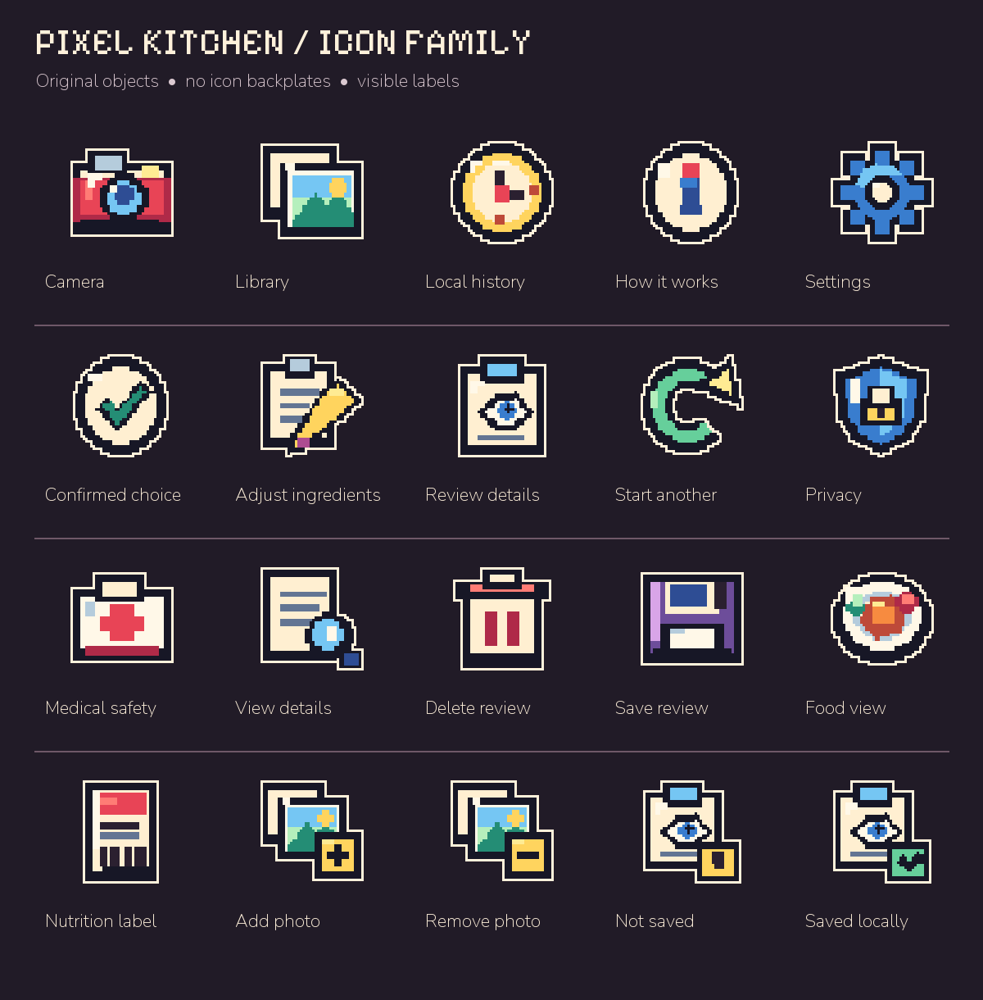
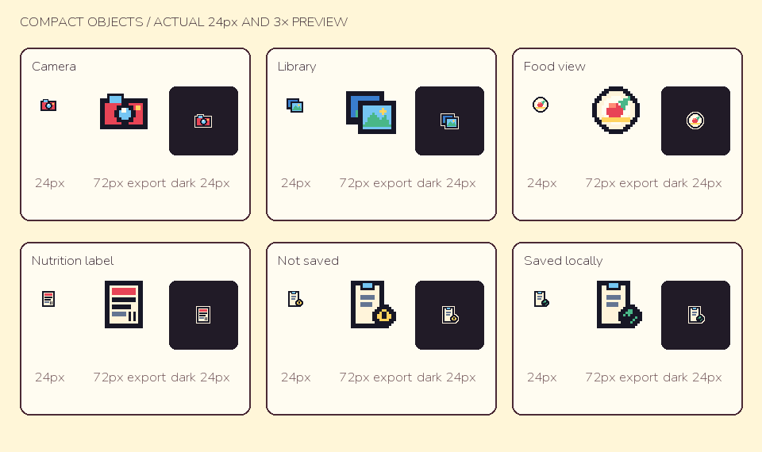

# Pixel Kitchen icon direction

**Build24 work in progress.** The regular eight-tooth Settings gear replaces the pointed version. The portable renderer reproduces all three handoff Settings exports exactly; the other 57 full-family PNG exports remain byte-identical. Native Settings-header inspection remains open.

**Floating pixel-object family, October 27, 2026.** Build23 refines the native Home hierarchy, stepped helper surface, dark decoration and photo-first accessibility-size order. Initial native viewports were inspected; full interactive/accessibility acceptance remains open. [Build23 evidence](../../research/visual/delivery-20261027-build23.json). Build23 is confirmed Testing in the existing internal group;22,19,2 remain.

**Historical integration, build22.** The applicant rejected the monochrome SF Symbol trial. This original dimensional pixel family replaces that proposed direction; neither rejected trial is in the app. Build 22 source uses the new object family and shared stepped surfaces; existing TestFlight build 19 still has its earlier appearance.

## Source and scope

The design chat supplied original floating objects without square backplates, plus six separately drawn compact roles. The [manifest](manifest.json) pins 60 full-family and 18 compact PNGs, and both actual renderer sources. The former square proposal is retained in Git history. Current asset bytes were copied unchanged; [full](generate_icons.py) and [compact](generate_compact.py) renderer copies only change output/font paths. Pillow is design tooling, not an app dependency. Atlas typography uses the already-bundled OFL fonts.

The source asset catalog contains 26 light/dark imagesets (52 PNGs). Main Camera/Library choices use 48-point objects; inline Camera/Library/food/label roles use separate compact drawings. Review status uses the full 48-point art. The compact pending/saved variants are imported but not exercised by a current 24-point call site. Home/Settings rows share grouped surfaces, and safety accents are clipped to the stepped outline. Native app layout, accessibility and human comprehension remain open; the concept portfolio is not proof of those gates.

## Native integration contract

- Cover all 20 existing icon roles coherently. Primary Camera/Library choices may use 48-point art; rows may use 32–40 points if their text and spacing remain clear.
- Detailed 48-pixel masters must not simply be shrunk to 24 points. Dedicated compact art or text-only treatment is required for inline photo/label/record roles. The six supplied compact roles are integrated; prefer text-only treatment for other tiny roles.
- Keep localized words visible and 44-point minimum touch targets. The parent control owns the accessible action/state; hide decorative artwork from VoiceOver.
- Avoid a second badge border around a tile that already has its own frame. Preserve adaptive surrounding text/ticket colors, Dynamic Type and script shaping.
- Camera and Library describe input sources. A label-document icon describes a selected label, never successful OCR. Saved/confirmed imagery must not imply food, carbohydrate or insulin accuracy.
- Keep the person's chosen meal photo as evidence. Never substitute an illustration for it, and do not add a food/success icon to an unknown result.
- Verify compact phone/iPad, light/dark, largest Dynamic Type, RTL, VoiceOver, Reduce Motion, loading/error, empty history and saved-detail states in the actual app before claiming visual completion. Independent human comprehension remains open.

21st.dev's [8-bit Button](https://21st.dev/@theorcdev/components/8bit-button) and [button guidance](https://21st.dev/blog/react-button-components) were consulted for hard-edge affordances and visible labels. No web component code, fonts, packages or assets were imported; native SwiftUI retains the existing design system.
