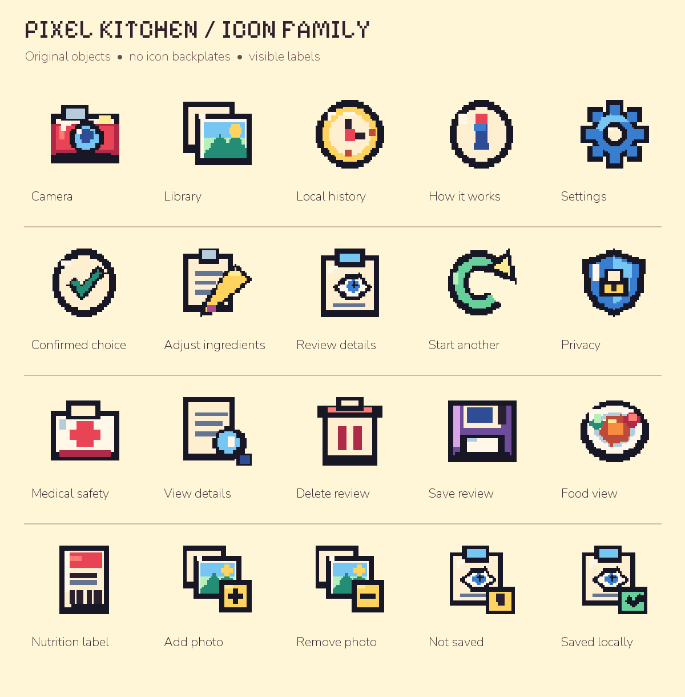

# Pixel Kitchen icon direction

**Dimensional pixel direction, October 27, 2026. This atlas is a review snapshot; native integration pending.** The applicant rejected the monochrome SF Symbol trial. This original dimensional pixel family replaces that proposed direction; neither rejected trial is in the app. The current shipping/test source still uses its earlier utility sprites.

## Source and scope

The design chat supplied these original drawings, created with AI coding assistance from primitive pixel shapes. User-supplied third-party app-icon references informed silhouette, stepped outlines, shade bands and hard shadows; their logos/artwork were not traced, copied or bundled. The selected MealMirror pot/MM emblem remains unchanged. The [manifest](manifest.json) pins the exact 20 masters and 20 nearest-neighbor exports. All PNG bytes were copied unchanged from the supplied design pack; no new raster edits were made in this batch. The portable [generator](generate_icons.py) changes output/font paths only. Pillow is research/design tooling, not an app dependency. Atlas typography uses the already-bundled OFL fonts; see the font licenses in `MealMirror.swiftpm/Fonts`.

The assets are source design material, outside the Challenge package. They add zero bytes to the current candidate ZIP. The portfolio is a concept, not native UI evidence or a final comprehension sign-off. The design chat is actively revising the backplates and screen surfaces; do not treat this snapshot as the final approved asset set.

## Native integration contract

- Cover all 20 existing icon roles coherently. Primary Camera/Library choices may use 48-point art; rows may use 32–40 points if their text and spacing remain clear.
- Detailed 48-pixel masters must not simply be shrunk to 24 points. Dedicated compact art or text-only treatment is required for inline photo/label/record roles. Compact variants are still pending.
- Keep localized words visible and 44-point minimum touch targets. The parent control owns the accessible action/state; hide decorative artwork from VoiceOver.
- Avoid a second badge border around a tile that already has its own frame. Preserve adaptive surrounding text/ticket colors, Dynamic Type and script shaping.
- Camera and Library describe input sources. A label-document icon describes a selected label, never successful OCR. Saved/confirmed imagery must not imply food, carbohydrate or insulin accuracy.
- Keep the person's chosen meal photo as evidence. Never substitute an illustration for it, and do not add a food/success icon to an unknown result.
- Verify compact phone/iPad, light/dark, largest Dynamic Type, RTL, VoiceOver, Reduce Motion, loading/error, empty history and saved-detail states in the actual app before claiming visual completion. Independent human comprehension remains open.

21st.dev's [8-bit Button](https://21st.dev/@theorcdev/components/8bit-button) and [button guidance](https://21st.dev/blog/react-button-components) were consulted for hard-edge affordances and visible labels. No web component code, fonts, packages or assets were imported; native SwiftUI retains the existing design system.
